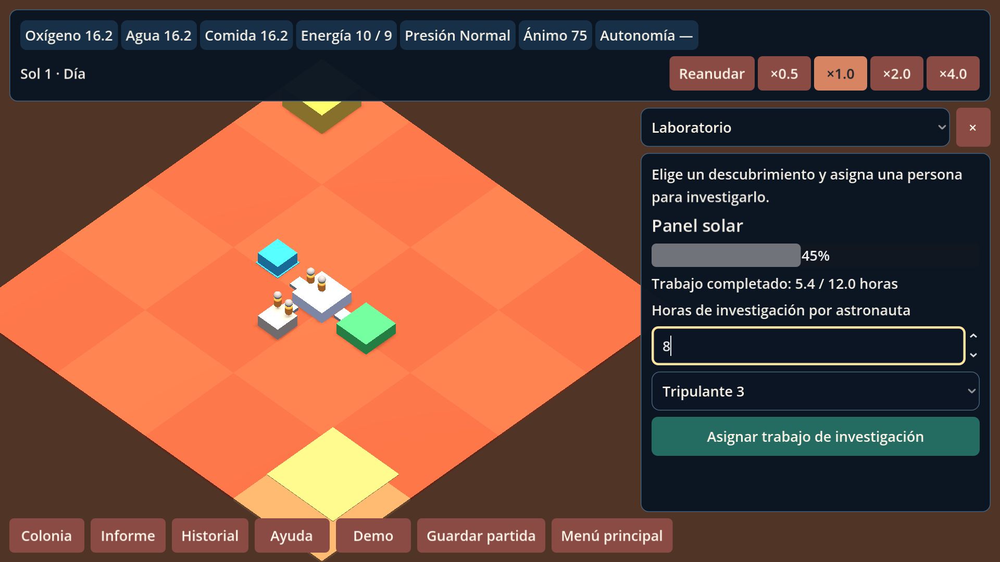

# Registro de bugs y pruebas de ruptura

Los 14 casos siguientes tienen corrección y prueba de regresión. Los dos reportados por el usuario son **QA-001** y **QA-002**. Las pruebas usan partidas y guardados aislados.

| ID | Prioridad | Bug | Estado |
| --- | --- | --- | --- |
| QA-001 | Alta | Investigación y barra sin progreso parcial | Corregido |
| QA-002 | Media | Día y noche visualmente indistinguibles | Corregido |
| QA-003 | Media | Trabajo bloqueado consume la jornada | Corregido |
| QA-004 | Alta | Apagar el invernadero congela el deterioro | Corregido |
| QA-005 | Alta | Baterías inactivas siguen aportando capacidad | Corregido |
| QA-006 | Alta | Impresión con edificio apagado antes del próximo tick | Corregido |
| QA-007 | Alta | Retirar el destino deja un astronauta ocupado | Corregido |
| QA-008 | Media | Reparaciones duplicadas y reservas retenidas | Corregido |
| QA-009 | Media | Una orden rechazada deja una acción huérfana | Corregido |
| QA-010 | Alta | Una partida nueva inválida borra la misión en memoria | Corregido |
| QA-011 | Alta | Guardados dañados superan la validación | Corregido |
| QA-012 | Media | Nueva misión hereda carga y cámara anteriores | Corregido |
| QA-013 | Media | Delta no finito bloquea la simulación | Corregido |
| QA-014 | Media | Cambiar astronauta no revalida acciones del cohete | Corregido |

## QA-001 — Investigación sin avance continuo

**Reproducir:** construir un laboratorio conectado, iniciar Panel solar, asignar ocho horas y simular diez segundos.

**Antes y causa:** progreso cero hasta terminar la tarea. El planificador entregaba horas únicamente al completar; investigación trataba cada ID como un bloque indivisible. La UI reconstruía el formulario o ignoraba cambios con un campo enfocado.

**Corrección:** acreditar trabajo incremental con una marca acumulativa por tarea. Actualizar barra y texto directamente, conservando el campo activo. Mostrar finalización explícita. Mantener el progreso al guardar/cargar o cancelar y recuperar horas parciales antiguas no acreditadas desde el registro real de la tarea.

**Prueba:** un médico produce 1,8 horas en diez segundos; dos producen 3,6/12 = 30 %. Se verificaron 30 %, 45 %, 75 % tras cargar, desbloqueo único y migración de progreso antiguo.



## QA-002 — Día/noche invisible

**Reproducir:** observar la colonia en los segundos 15 y 45 de un sol.

**Antes y causa:** luz principal de 1,25 en ambos momentos; la producción solar cambiaba, pero la iluminación era constante y el HUD no mostraba la fase.

**Corrección:** iluminación, sombras, ambiente y fondo siguen el reloj; indicador Día/Noche y tiempo hasta el cambio. El relleno ambiental nocturno conserva legibilidad: es una ayuda visual, no una simulación astronómica.

**Prueba:** luz directa 1,25 de día y 0,10 de noche; el mismo panel produce 8 y 0,4. Pausa y carga conservan la fase. [Día](day-1920.png) · [Noche](night-1920.png).

## QA-003 — Horas consumidas sin trabajar

**Reproducir:** asignar investigación y cortar la energía del laboratorio.

**Antes y causa:** la tarea no avanzaba, pero Tripulación consumía horas antes de comprobar el resultado del planificador.

**Corrección y prueba:** el planificador devuelve el trabajo real. Las tareas bloqueadas consumen cero horas, fatiga de trabajo y exposición EVA por trabajo no realizado. El presupuesto diario permanece intacto durante el bloqueo.

## QA-004 — Cultivos inmunes al apagar

**Reproducir:** apagar el invernadero y simular más de medio sol.

**Antes y causa:** producción omitía todos los edificios apagados, incluyendo el deterioro del cultivo.

**Corrección y prueba:** evaluar suministro y gracia aunque esté apagado. El cultivo deja de producir y muere al superar la gracia configurada.

## QA-005 — Baterías inactivas que funcionan

**Reproducir:** construir una batería y apagarla o destruirla.

**Antes y causa:** capacidad y tasas se sumaban sin comprobar actividad o salud.

**Corrección y prueba:** solo baterías sanas y encendidas aportan capacidad utilizable. La carga de una batería apagada queda reservada y vuelve al encenderla: se comprobaron diez unidades conservadas. Una batería destruida no aporta capacidad.

## QA-006 — Impresión con edificio apagado

**Reproducir:** alimentar una impresora, apagarla e imprimir antes del siguiente paso de energía.

**Antes y causa:** la receta usaba solo la asignación eléctrica anterior y podía gastar materiales y crear productos.

**Corrección y prueba:** comprobar actividad y salud actuales antes de gastar. Operación rechazada e inventario intacto. El fixture aporta potencia suficiente para evitar un falso resultado por falta de energía.

## QA-007 — Astronauta bloqueado sin destino

**Reproducir:** asignar investigación y retirar el laboratorio.

**Antes y causa:** quedaba el ID de tarea en el astronauta; el destino desaparecido nunca podía completarla.

**Corrección y prueba:** retirar cancela las tareas dirigidas al edificio y libera la tripulación. Hay comprobación de destino en el planificador y limpieza de tareas antiguas al cargar. Liberación inmediata verificada.

## QA-008 — Reparaciones duplicadas

**Reproducir:** asignar dos reparaciones a la misma brecha; cancelar la primera.

**Antes y causa:** se admitían órdenes redundantes y cancelar no liberaba el registro pendiente del edificio.

**Corrección y prueba:** una acción pendiente por edificio. La segunda reparación se rechaza y cancelar libera la reserva, sin devolver trabajo ya realizado.

## QA-009 — Orden rechazada con efectos

**Reproducir:** prohibir Producción a un astronauta e intentar una recarga.

**Antes y causa:** se creaba la acción del edificio antes de que el planificador rechazara la categoría.

**Corrección y prueba:** validar antes de crear y deshacer la reserva si falla el encolado. La carga limpia reservas antiguas sin tarea asociada. Rechazo sin acciones nuevas y recuperación de un guardado antiguo verificados.

## QA-010 — Partida inválida borra la anterior

**Reproducir:** con una misión activa, iniciar otra con un perfil inexistente.

**Antes y causa:** el estado se reiniciaba antes de validar el roster; el fallo dejaba una misión vacía y podía perder progreso no guardado.

**Corrección y prueba:** inicio transaccional; restaurar el estado previo si falla roster o layout y reconstruir cachés cuando corresponde. Se comprueba igualdad completa con la misión anterior.

## QA-011 — Guardados dañados aceptados

**Reproducir:** importar copias con reloj NaN, origen de una sola coordenada, datos de terreno con tipos inválidos o hechos que no son registros.

**Antes y causa:** la validación revisaba principalmente secciones superiores e inventario; las estructuras interiores podían romper servicios y vistas.

**Corrección y prueba:** validar finitud, tipos, formas, rangos y particiones antes de reemplazar la misión. Las mutaciones se rechazan con ERR_INVALID_DATA y sin cambiar el estado actual. Los guardados válidos y formatos anteriores de investigación siguen cargando.

## QA-012 — Datos de interfaz arrastrados

**Reproducir:** escribir un borrador de carga, alejar la cámara e iniciar otra misión.

**Antes y causa:** esos datos vivían en objetos reutilizados y no se reiniciaban.

**Corrección y prueba:** reiniciar borradores, selección de herramienta y vista de cámara al crear una misión válida. Carga vacía y cámara centrada; idioma y escala se conservan.

## QA-013 — Delta inválido bloquea el reloj

**Reproducir:** llamar a session.update(NAN) desde una integración o prueba.

**Antes y causa:** el acumulador se convertía en NaN y no volvía a ejecutar pasos.

**Corrección y prueba:** rechazar deltas negativos/no finitos. También se protegen colocaciones nulas, horas no finitas y tipos de tarea no soportados. Acumulador finito bajo entradas inválidas y acciones mezcladas.

## QA-014 — Acciones del cohete desactualizadas

**Reproducir:** aterrizar, refugiar al primer astronauta, abrir Cohete y elegir otro disponible.

**Antes y causa:** Desmantelar seguía deshabilitado por la validación del primer astronauta; cambiar la selección no recalculaba botones ni mensajes.

**Corrección y prueba:** revalidar al cambiar astronauta o perfil. Mostrar nombres legibles conservando IDs como metadatos. Seleccionar al segundo astronauta habilita la acción válida.

## Evidencias

- [Registro inicial](before.json), [reproducción de API](before-api.json) y [reproducción del selector](before-ui.json).
- [Después: 32 comprobaciones dirigidas](after.json).
- [Estrés: 1.000 operaciones, 9.795 comprobaciones y cinco semillas](stress-results.json).
- [Prueba gráfica: 23 comprobaciones y siete capturas](visual-results.json).
- [Layout: 106 capturas, seis resoluciones, EN/ES y escala ampliada](layout-results.json).
- Siete suites previas ejecutadas, incluidas victoria de 42 soles y derrota.
- [Salida completa de las nueve suites de la regresión final](regression.log).

La suite fue ampliándose: los totales anteriores y posteriores no son la misma cantidad de casos. En QA-005 se corrigió además el fixture inicial, que suponía un ID de batería fijo; la prueba final usa el ID real devuelto por place. La causa original de ese bug se confirmó también por lectura del código.

## Repetir las pruebas

Configura APPDATA en una carpeta de pruebas antes de ejecutar las escenas headless: crean misiones y autosaves. El cliente MCP hace ese aislamiento automáticamente.

```powershell
$godotExecutable = 'C:/Users/emili/Desktop/Godot_v4.7.2-stable_win64.exe/Godot_v4.7.2-stable_win64_console.exe'
$qaOriginalAppData = $env:APPDATA
try {
    $env:APPDATA = Join-Path $PWD '.test_playable/manual-qa'
    & $godotExecutable --headless --path . res://tests/qa/run_break_tests.tscn
    & $godotExecutable --headless --path . res://tests/qa/run_stress_tests.tscn
} finally {
    $env:APPDATA = $qaOriginalAppData
}
node tools/godot-mcp/check-playable.mjs res://tests/qa/run_visual_regressions.tscn qa-visual-result.json
```

## Alcance y observaciones

Verificado con el motor local, sin certificar exportaciones Web/Windows ni ausencia de cualquier otro bug. Las pruebas aleatorias son acotadas y reproducibles. Algunos fixtures aislados emiten avisos ObjectDB/recursos al cerrar; se conserva esa salida y no se presenta como una fuga de una partida confirmada ni como un problema resuelto aquí.
